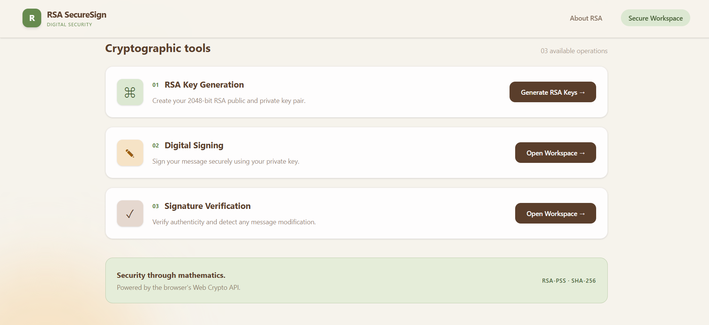
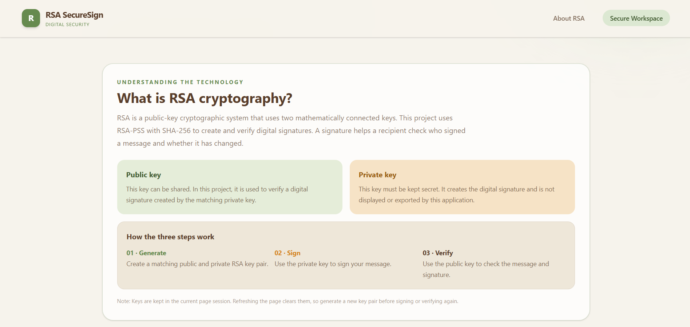
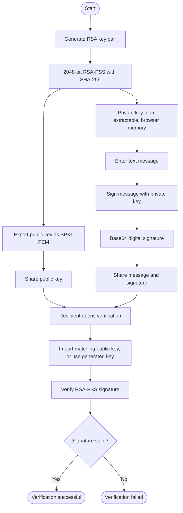

# RSA SecureSign

A browser-based RSA digital signature application built with **React**, **JavaScript**, and the **Web Crypto API**. RSA SecureSign demonstrates how to generate an RSA key pair, sign text messages, and verify signatures using a public key.

<p align="center">
  <a href="https://rsa-secure-sign-phi.vercel.app/"><strong>🚀 Live Demo</strong></a> ·
  <a href="https://github.com/Junaid-akhter/RSA-SecureSign"><strong>💻 GitHub Repository</strong></a> ·
  <a href="https://www.linkedin.com/in/junaid-akhter-312010380/"><strong>LinkedIn</strong></a>
</p>

## Overview

RSA SecureSign is an educational project created to demonstrate the practical use of public-key cryptography for digital signatures. It provides three main operations: RSA key generation, digital signing, and signature verification. A user can also import a public key in PEM format to verify a signature independently.

## Application Screenshots

### Secure Workspace

The workspace brings together the three main operations: key generation, digital signing, and signature verification.



### About RSA

The About RSA page explains the roles of public and private keys and the generate–sign–verify process used by the application.



## Features

- Generate a 2048-bit RSA-PSS public/private key pair.
- Keep the private key non-extractable and in browser memory; it is not displayed or exported by the application.
- Export and copy the public key in SPKI PEM format.
- Sign text messages with the private key.
- Verify signatures using the generated public key or an imported PEM public key.
- Detect message changes by checking the signature against the message.
- Copy the generated signature for sharing.

## How It Works

The diagram below follows the application's implemented signing and verification flow. The sender generates a key pair, signs a message with the private key, and shares the message, signature, and public key. The recipient can import the public key and verify the signature.



## Cryptographic Configuration

| Parameter | Value |
|---|---|
| Signature algorithm | RSA-PSS |
| RSA modulus length | 2048 bits |
| Public exponent | 65537 |
| Hash function | SHA-256 |
| PSS salt length | 32 bytes |
| Public key export format | SPKI PEM |
| Signature representation | Base64 |
| Browser cryptography interface | Web Crypto API |

## Technology Stack

- **React** – user interface
- **JavaScript** – application logic
- **Vite** – development server and build tool
- **Tailwind CSS v4** – styling
- **Web Crypto API** – RSA key generation, signing, and verification
- **Vercel** – deployment

## Run Locally

Make sure Node.js and npm are installed.

1. Clone the repository:

   ```bash
   git clone https://github.com/Junaid-akhter/RSA-SecureSign.git
   ```

2. Move into the project directory:

   ```bash
   cd RSA-SecureSign
   ```

3. Install dependencies:

   ```bash
   npm install
   ```

4. Start the development server:

   ```bash
   npm run dev
   ```

5. Open the local URL shown in the terminal.

To create a production build, run:

```bash
npm run build
```

## Testing

| Test | Expected outcome |
|---|---|
| Sign a message and verify it with the matching public key | Verification successful |
| Change the message after signing | Verification failed |
| Import the matching public key and verify | Verification successful |
| Use a non-matching public key or invalid signature | Verification failed |

## Security Notes and Limitations

- The private key is generated as non-extractable and is not exported by the application.
- Key objects remain in browser memory for the current page session. Refreshing the page clears them, so a new key pair must be generated before signing again with that session.
- The application signs text messages; it does not encrypt messages or conceal their contents.
- A successful verification shows that the message and signature match the supplied public key. It does not, by itself, prove the real-world identity of the person who supplied that key. Public keys must be obtained through a trusted channel when identity matters.
- This project is an educational demonstration, not a complete production identity or certificate-management system.

## Learning Outcomes

This project provided practical experience with RSA public-key cryptography, digital signatures, message integrity, the Web Crypto API, public-key import/export, and deploying a React application.

## Developer

**Junaid Akhter**

- GitHub: [Junaid-akhter](https://github.com/Junaid-akhter)
- LinkedIn: [Junaid Akhter](https://www.linkedin.com/in/junaid-akhter-312010380/)

---

<p align="center"><strong>RSA SecureSign — Security through mathematics.</strong></p>
